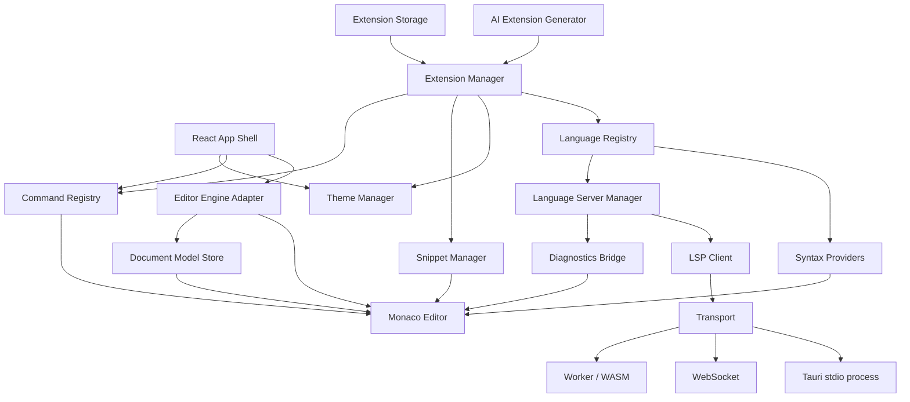

# Monaco Migration Research

**Project:** Arc (`arc-ide` 0.1.2, identifier `dev.arc.ide`)  
**Scope:** research only. No application code, dependencies, or build configuration were changed.  
**Date:** 2026-11-16  
**Primary question:** should Arc replace CodeMirror 6 with Monaco Editor, and if so, how should the editor, language support, and extension system be structured?

---

## 1. Executive summary

Arc currently uses **CodeMirror 6**, not CodeMirror 5. The editor is deeply integrated into `src/App.tsx` and `src/lib/pluginRuntime.ts`:

- one `EditorView` per open file per editor group;
- document text owned by React state/refs outside CodeMirror;
- CodeMirror `Compartment`s for settings, theme, and language;
- a plugin system that exposes raw CodeMirror modules and CodeMirror-shaped editor operations;
- no native diagnostic rendering and no real language-server integration;
- a custom theme system that generates `.cm-*` CSS and a Lezer `HighlightStyle`.

Monaco 0.57.0 is a credible replacement for the **editor surface**. It provides models, multiple views per model, a diff editor, minimap, multi-cursor, folding, decorations, semantic tokens, code lens, inlay hints, formatting, and a broad provider API. Monaco 0.57 also ships an **alpha-stage official LSP client** (`monaco.lsp`) with no stdio transport and no workspace-root configuration. That client is promising but not production-ready for Arc as-is.

The migration is **not just an editor swap**. The expensive parts are:

1. replacing CodeMirror-specific document/view lifecycle and compartments;
2. rebuilding the plugin editor/language APIs so plugins do not depend on CodeMirror;
3. preserving the existing theme and CSS customization;
4. building a language architecture that supports syntax-only languages and full LSP languages;
5. proving web workers and Monaco assets work inside Tauri's bundled asset protocol.

**Recommendation:** migrate incrementally, but treat it as an editor-layer rewrite with a compatibility period, not a drop-in dependency replacement. Use **plain Monaco + an Arc-owned editor adapter**, keep Arc's own document state as the source of truth initially, and build an editor-agnostic language registry. Use Monarch as the primary AI-generated syntax format, optional TextMate for VS Code grammar compatibility, and a **custom LSP client bridge** first; evaluate `monaco.lsp` behind a feature flag only after its alpha limitations are resolved or patched. Do not adopt `monaco-languageclient` v11 as the initial integration: it brings the CodinGame VS Code API layer and its own editor application lifecycle, which conflicts with Arc's existing shell and incremental migration goals.

The migration is worth doing **if** the roadmap depends on richer code intelligence, AI-generated language support, shared document models, diff/minimap/multi-cursor, and a more VS Code-like editing experience. It is **not** worth doing merely to make Arc look like VS Code; CodeMirror 6 already covers the core editing experience and is substantially lighter and simpler to embed.

---

## 2. Current implementation audit

### 2.1 Stack and dependencies

From `package.json`:

| Area | Current dependency |
| --- | --- |
| UI | React 19, React DOM 19, Vite 6, TypeScript 5.7 strict |
| Desktop | Tauri 2, `@tauri-apps/api`, plugin-fs, plugin-dialog, plugin-clipboard-manager, plugin-opener |
| Editor | CodeMirror 6 packages |
| Syntax | `@codemirror/lang-*`, `@lezer/highlight` |
| Formatting | Prettier 3 standalone |
| Terminal | `rioterm` |
| Icons/markdown | `lucide-react`, `react-icons`, `react-markdown`, `remark-gfm` |

CodeMirror packages in the repo:

- `@codemirror/autocomplete` ^6.18.6
- `@codemirror/commands` ^6.8.1
- `@codemirror/lang-css` ^6.3.1
- `@codemirror/lang-html` ^6.4.9
- `@codemirror/lang-javascript` ^6.2.3
- `@codemirror/lang-json` ^6.0.2
- `@codemirror/lang-markdown` ^6.3.2
- `@codemirror/lang-php` ^6.0.2
- `@codemirror/language` ^6.11.2
- `@codemirror/search` ^6.5.11
- `@codemirror/state` ^6.5.2
- `@codemirror/view` ^6.38.6
- `@lezer/highlight` ^1.2.5

There is currently **no Monaco**, **no LSP client package**, **no TextMate package**, and **no Tree-sitter package** in the repository. There is no frontend test runner; `npm run build` is the typecheck and production-build gate. Rust tests live in `src-tauri/src/lib.rs`.

### 2.2 Relevant files and responsibilities

| File | Responsibility relevant to migration |
| --- | --- |
| `src/App.tsx` | App shell, file tree, tabs, split layout, `EditorPane`, `SplitContainer`, command palette, context menus, workspace state, editor settings, theme application, language loading, save/format flow, plugin host actions. |
| `src/lib/pluginRuntime.ts` | Plugin loader and plugin API. Exposes CodeMirror modules, editor operations, decorations, language providers, diagnostics storage, LSP process helper, commands, keybindings, themes, panels, storage, and more. |
| `src/lib/settings.ts` | `AppSettings`, `DEFAULT_SETTINGS`, `APP_SETTINGS_VERSION = 3`, `ThemeColors`, `ThemeDefinition`, `BUILTIN_THEMES`, `themeCss()`. |
| `src/components/SettingsPanel.tsx` | Settings UI for editor and application settings. |
| `src/components/ThemeMaker.tsx`, `ThemeColorPicker.tsx` | Custom theme authoring and color editing. |
| `src/components/GithubPanel.tsx` | Git/GitHub panel; not editor-engine dependent. |
| `src/components/PluginPanel.tsx` | Plugin install/enable/disable/remove UI. |
| `src/components/TerminalView.tsx` | Terminal; not editor-engine dependent. |
| `src/lib/terminalOutput.ts` | Global terminal output buffer; not editor-engine dependent. |
| `src-tauri/src/lib.rs` | PTY, workspace access gating, GitHub CLI integration, plugin processes/sockets/HTTP/secrets, local server, file watcher, window effects. |
| `plugins/live-server`, `plugins/xampp`, `plugins/api-tester` | Built-in plugins, each with `plugin.json` and self-contained `main.js`. |
| `PLUGIN_API.md` | Plugin API contract. Must be kept in sync with any API change. |
| `ARC_AGENT_KIT.md` | Agent-facing plugin/theme generation contract. |
| `FILE_WATCHER.md` | File-watcher design and implementation notes. |
| `README.md` | User-facing feature list; currently says language-server support is not included. |

### 2.3 Editor initialization and lifecycle

The editor is created in `EditorPane` (`src/App.tsx:804`). Each file tab in each editor group owns a separate `EditorView`:

```ts
const view = useRef<EditorView | null>(null);
const [compartments] = useState(() => ({
  settings: new Compartment(),
  theme: new Compartment(),
  language: new Compartment(),
}));

const editor = new EditorView({
  parent: host.current,
  state: EditorState.create({
    doc: file.content,
    extensions: [
      history(),
      highlightSelectionMatches(),
      compartments.settings.of([]),
      compartments.theme.of([]),
      compartments.language.of([]),
      pluginEditorExtensions,
      EditorView.updateListener.of(/* ... */),
      EditorView.domEventHandlers({
        focus: () => {
          onActivate(group.id);
          return false;
        },
      }),
    ],
    selection:
      snapshot.current?.path === file.path
        ? snapshot.current.selection
        : undefined,
  }),
});
```

`editorViews` is a nested map:

```ts
{ current: Map<string, Map<GroupId, EditorView>> }
```

- `file.path -> group.id -> EditorView`
- `SplitContainer` (`src/App.tsx:1368`) renders nested layout nodes.
- Dragging a tab to an edge creates a split.
- Each group mounts its own `EditorView` for the same file.
- On unmount, the view calls `onChange(file.path, editor.state.doc.toString())`, saves a snapshot (`path`, `selection`, `scrollTop`, `scrollLeft`), and destroys the view.

### 2.4 Document state ownership

Document content is **outside** the editor:

- `openFiles` state stores `{ path, name, revision, dirty }`.
- `fileContents` ref stores `Map<path, string>`.
- `OpenFile` type is around `src/App.tsx:159`; `EditorFile = OpenFile & { content }`.
- Tauri plugin-fs reads and writes files directly.
- `updateFile(path, content, replace?)` updates refs/state and bumps `revision`.
- Save writes the file, optionally applies Prettier, and handles conflict/dirty state.
- When `file.revision` changes, a sync effect replaces the CodeMirror document using an `externalContentUpdate` annotation (`src/App.tsx:371`) and `Transaction.addToHistory.of(false)`; it preserves selection and scroll.

This is important for Monaco: Monaco models naturally own text and undo history. Arc can keep its external state as the source of truth, but doing so creates duplicate ownership. The cleaner target is:

- one Monaco model per open file, keyed by a stable URI;
- multiple Monaco editors share that model;
- `fileContents` remains a cache/save buffer only while migrating;
- close/dispose policy owns model lifetime.

### 2.5 Editor settings and dynamic reconfiguration

Settings are applied by reconfiguring a CodeMirror `Compartment` (`src/App.tsx` around lines 995–1065):

- `EditorState.tabSize`
- `indentUnit`
- optional `lineNumbers()`
- keymap combining `closeBracketsKeymap`, template expansion on `Tab`, `defaultKeymap`, `searchKeymap`, `historyKeymap`, `indentWithTab`
- optional `bracketMatching()`, `closeBrackets()`, `indentOnInput()`
- `highlightActiveLine()`, `highlightActiveLineGutter()`
- custom `indentationGuides(tabSize)` (`src/App.tsx:392`)
- `EditorView.lineWrapping`
- `autocompletion()`
- `EditorView.theme` for height, font, autocomplete tooltip, focus styles

Defaults in `DEFAULT_SETTINGS`:

- tab size 2
- font size 13
- line height 1.7
- autocomplete on
- line numbers on
- indent guides on
- active line on
- auto-close brackets on
- bracket matching on
- auto indent on
- word wrap off

Other settings include `prettierOnSave`, `fontFamily`, `selectedTheme`, `appTheme`, editor/glass transparency, and `zoomLevel`.

`resolveEditorFont(settings)` chooses the editor font. `prettierFormat` (`src/App.tsx:644`) uses `prettier/standalone` plus dynamic plugins for HTML/SVG/Vue, CSS/SCSS, Babel/ESTree, TypeScript, JSON, Markdown/MDX, and YAML. `formatFile` updates the file through `updateFile(path, formatted, true)`. `Alt+Shift+F` formats the active file.

### 2.6 Theme and syntax highlighting

`buildCodeHighlighting(theme)` (`src/App.tsx:342`) returns a CodeMirror `HighlightStyle` mapping Lezer tags to theme color slots:

| Lezer tag | Theme slot |
| --- | --- |
| keyword | keyword |
| controlKeyword, definitionKeyword | control |
| string, special string | string |
| number, bool, null | number |
| function (variableName/propertyName) | function |
| typeName, className, namespace | type |
| propertyName, attributeName | property |
| tagName, self | tag |
| attributeValue | attribute |
| operator, punctuation, separator | operator |
| comment | comment (italic) |
| meta | meta |
| invalid | invalid + invalidBackground |

The theme compartment applies `syntaxHighlighting(buildCodeHighlighting(theme))` plus `EditorView.theme` rules for:

- editor background and text;
- gutters;
- active line and active gutter;
- cursor glow/border;
- selection;
- `.cm-tooltip*`;
- autocomplete selection and detail.

`src/lib/settings.ts:407` `themeCss()` generates extensive `.cm-*` CSS, including:

- `.cm-editor`
- `.cm-scroller`
- `.cm-gutters`
- `.cm-activeLine`
- cursor and selection
- indent-guide gradient
- token classes such as `.cm-keyword`, `.cm-string`
- autocomplete styling

`src/styles/styles.css` and `src/styles/app-themes.css` also style `.cm-*` selectors. A Monaco migration must replace or dual-maintain these mappings.

Indent guides are custom:

- `indentGuideMark = Decoration.mark({ class: 'cm-indent-guide' })`
- `buildIndentGuides(view, tabSize)` scans visible ranges and marks leading indentation when its length is at least `tabSize`.
- `indentationGuides(tabSize)` is a `ViewPlugin` that updates on document/viewport changes.
- CSS uses a gradient at `tabSize` character width.

`expandDocumentTemplate(view, extension)` (`src/App.tsx:570`) runs on `Tab` at end-of-document when the document matches `/^\s*!\s*$/`:

- expands HTML/HTM/PHP boilerplate;
- for PHP, prepends `<?php\n\n?>\n`;
- places the cursor in the body or PHP block;
- returns a boolean.

### 2.7 Language support

`loadCodeLanguage(extension)` (`src/App.tsx:770`) dynamically imports CodeMirror language packages:

| Extension | CodeMirror support |
| --- | --- |
| html, htm, svg | `html()` |
| php | `php()` plus `phpLanguage.data.of({ autocomplete: phpCompletion })` |
| css, scss | `css()` |
| js, mjs, cjs, jsx, ts, tsx | `javascript({ jsx: true, typescript: ... })` |
| json, jsonc | `json()` |
| md, mdx | `markdown()` |
| other | empty extension list |

There is a static PHP completion list of roughly 60 keywords/functions/classes/variables. `phpCompletion(context)` uses `matchBefore(/[$A-Za-z_][\w$]*/)` and returns `{ from, options, validFor }`.

Plugin languages are declared through:

```ts
type PluginLanguageDefinition = {
  id: string;
  name: string;
  extensions?: string[];
  filenames?: string[];
  aliases?: string[];
  configuration?: unknown;
  load: () => Extension | Promise<Extension>;
};
```

A contribution adds `pluginId` and `pluginName`. In `EditorPane`, language resolution is:

1. `pluginLanguageOverrides[file.path]`;
2. a plugin contribution matching extension or filename;
3. `loadCodeLanguage(override ?? extension)`.

The editor then combines `pluginGrammarFor(id)` for the contribution id, suffix id, override, and extension, then calls `compartments.language.reconfigure(language)`.

`pluginLanguageOverrides` is app state; `setEditorLanguage(path, id)` sets the override. `pluginGrammarVersion` is bumped when a grammar is registered or disposed. Grammars are stored in a `Map<languageId, Extension | Promise<Extension>>`.

There is **no real semantic language-server integration** in the application. A plugin can call `startServer`, but it must wire requests and responses manually.

`README.md` line 54 states that Arc provides HTML tag and PHP completion and **does not include language-server support yet**. Prettier support covers HTML/SVG/Vue/CSS/SCSS/JS/TS/JSON/Markdown/YAML.

### 2.8 Autocomplete, diagnostics, and intelligence

CodeMirror autocompletion is enabled by a setting unless disabled. Plugin completion providers are registered through `api.languages.registerCompletionProvider`. `pluginCompletionSource(context)` is attached through `EditorState.languageData.of(() => [{ autocomplete: pluginCompletionSource }])`, invokes all matching providers, and returns `{ from, options }`. Completion types come from CodeMirror's `Completion`.

Diagnostics are a **functional gap**:

- `api.diagnostics.createCollection(name)` stores `Map<uri, unknown[]>` and emits `diagnostics:changed`.
- No application listener converts those diagnostics into CodeMirror squiggles or gutter markers.
- Plugin diagnostics are currently event data, not rendered editor diagnostics.

Hover is implemented with `hoverTooltip` (`src/lib/pluginRuntime.ts:3292`). It invokes plugin hover providers, accepts string or `{ text, contents, html }`, shows a temporary "Loading…" state for async providers, and renders custom `.arc-plugin-hover` DOM.

Folding is implemented with `foldService.of(...)` (`src/lib/pluginRuntime.ts:3330`) and delegates to plugin folding providers by line.

Semantic tokens, code lens, and inlay hints are implemented through a `ViewPlugin` plus decorations:

- `.arc-plugin-code-lens`
- `.arc-plugin-inlay-hint`
- `.arc-semantic-token arc-semantic-<kind>`

Selection range is applied by `pluginExpandSelection(view)` on `Shift-Alt-ArrowRight`.

Definition, references, rename, code actions, signature help, document symbols, and workspace symbols are implemented as command-palette/quick-pick workflows, not native Monaco-style UI:

- `pluginGoToDefinition` (`src/lib/pluginRuntime.ts:2953`)
- `pluginFindReferences` (`src/lib/pluginRuntime.ts:2959`)
- `pluginRenameSymbol` (`src/lib/pluginRuntime.ts:3001`)
- `pluginDocumentSymbols` (`src/lib/pluginRuntime.ts:3043`)
- `pluginWorkspaceSymbols` (`src/lib/pluginRuntime.ts:3069`)
- `pluginCodeActions` (`src/lib/pluginRuntime.ts:3086`)
- `pluginSignatureHelp` (`src/lib/pluginRuntime.ts:3110`)
- `openPluginLocation` (`src/lib/pluginRuntime.ts:2906`)
- `applyPluginWorkspaceEdit` (`src/lib/pluginRuntime.ts:2985`)
- `normalizeLocation` converts LSP-like ranges to offsets; URI/path helpers exist.

`pluginLanguageKeymap` (`src/lib/pluginRuntime.ts:3354`) binds:

| Key | Action |
| --- | --- |
| F12 | go to definition |
| Shift-F12 | find references |
| F2 | rename symbol |
| Mod-. | code actions |
| Shift-Alt-ArrowRight | expand selection |
| Ctrl-Shift-Space | signature help |

The app-level command palette also exposes equivalents.

There is an LSP process helper, `startPluginLanguageServer` (`src/lib/pluginRuntime.ts:3846`):

- spawns a plugin process through `plugin_process_spawn`;
- implements JSON-RPC framing with `Content-Length`;
- supports `request`, `notify`, `onNotification`, `onRequest`, `shutdown`;
- sends `initialize` with `processId: null`, root URI/workspace folders from the current working directory, and capabilities for dynamic text-document synchronization and workspace folders;
- sends `initialized`.

It does **not** provide automatic document synchronization, a Monaco adapter, or diagnostics hookup. The plugin owns all wiring.

Plugin provider kinds are:

`completion`, `hover`, `definition`, `reference`, `rename`, `formatting`, `codeAction`, `codeLens`, `inlayHints`, `signatureHelp`, `documentSymbol`, `workspaceSymbol`, `semanticTokens`, `folding`, `selectionRange`.

A provider entry is `{ kind, selector, provider, pluginId }`. Selectors support language, scheme, and pattern matching through `selectorMatches`. Registrations return disposables; provider failures are isolated. `registerGrammar(languageId, { load })` stores an extension or promise and combines it with the language.

### 2.9 Plugin and extension architecture

A plugin manifest is minimal:

```json
{
  "id": "example.plugin",
  "name": "Example",
  "version": "1.0.0",
  "description": "Example plugin",
  "main": "main.js"
}
```

Validation rules:

- `id` must match `^[a-z0-9][a-z0-9._-]{1,63}$`;
- `name`, `version`, and `description` must be non-empty;
- `main` must be exactly `"main.js"`;
- built-in plugin IDs are reserved.

Plugins load from:

- `<appData>/plugins/<id>/plugin.json`
- `<appData>/plugins/<id>/main.js`

Built-in plugins are inlined at build time with `import.meta.glob` of `../../plugins/*` and seeded into the plugin store.

Activation uses:

```ts
URL.createObjectURL(new Blob([source], { type: 'text/javascript' }));
// then dynamic import(url)
// then exported activate(api)
```

There is **no sandbox**. Plugin JavaScript runs in the renderer and receives broad access, including `invoke`, files, terminal, processes, network/secrets, and more. Installation uses:

```text
Install “name”? Plugin JavaScript runs inside Arc and can call its plugin API.
```

`PluginApi` includes:

- `plugin`, `workspace`, `platform`
- `invoke`, `openUrl`, `openTerminal`, `notify`, `supports`
- `disposables`, lifecycle hooks, timers, workers
- assets, files, paths
- `editor` with getters, edits, decorations, diff, content providers, custom editors, pre-save, events
- `languages`, `diagnostics`
- `terminal`, `settings`, `themes`
- dialogs, clipboard, window
- `ui` actions, commands, panels, views, quick pick, input, progress, notifications, output, context
- commands, keybindings, events, storage, configuration
- workers, secrets, auth, tasks, tests, debug, MCP
- a hardcoded `SUPPORTED_CAPABILITIES` set

`PluginEditorContext`:

```ts
{
  path, uri, name, language, version,
  cursor: { line, column, offset },
  selection: { from, to },
  selections, dirty, focused, visibleRanges
}
```

`PluginEditorSnapshot`:

```ts
{ path, name, text, dirty, selection }
```

App builds these from `openFiles`, `fileContents`, the active CodeMirror view (`state.doc`, `state.selection`, `visibleRanges`, `hasFocus`), `editorViews`, and `lastActiveEditorPath`.

Emitted events include:

- `editor:active`
- `editor:active-changed`
- `editor:context-changed`
- `editor:changed`
- `document:opened`
- `document:closed`
- `settings:changed`
- `workspace:changed`
- command and keybinding events
- `diagnostics:changed`

`api.editor` is CodeMirror-specific:

- `insertText`, `setText`
- `getSelection`, `setSelection`
- `replaceRange`, `applyEdits`, `applyWorkspaceEdit`
- `insertSnippet` (`parseSnippet` strips `${1:...}`/`$1` and finds the cursor)
- `revealRange` via `CodeMirrorView.scrollIntoView`
- `openAt` by line/column
- `setLanguage`
- `registerDecorationType` / `setDecorations` via `StateEffect` + `StateField` + `ViewPlugin`
- `openDiff` as a custom overlay, not a real diff editor; reads URIs and renders `<pre>` columns
- `registerCustomEditor` container mount
- `onWillSave` content transformation

All of these need redesign or an adapter for Monaco models and editors.

### 2.10 App-level keyboard and commands

The global `window` keydown handler in `App.tsx` (around lines 3920–4100) handles:

| Shortcut | Action |
| --- | --- |
| Ctrl/Cmd+Shift+P | command palette |
| plugin keybindings | via `pluginRuntime.keybindings` and `matchesPluginShortcut` |
| plugin command shortcuts | plugin commands |
| Ctrl/Cmd+T | terminal |
| Ctrl/Cmd+N | new file/folder |
| file-tree copy/paste/undo | file tree |
| Ctrl/Cmd+, | settings |
| Ctrl/Cmd +/-/0 | zoom |
| Ctrl/Cmd+K then O | open workspace |
| Ctrl/Cmd+B | toggle viewer |
| Ctrl/Cmd+W | close tab |
| Ctrl/Cmd+S | save |
| Alt+Shift+F | format active file |
| F2 / Delete | rename/delete in tree |
| Ctrl/Cmd+/ | split editor (Shift for horizontal) |

CodeMirror keymaps include the default keymap, history, search, close brackets, indent-with-tab, and the template-expansion `Tab` handler. Plugin commands appear in the command palette.

### 2.11 Theme system

`ThemeColors` includes approximately 32 slots:

`background`, `sidebar`, `editor`, `raised`, `border`, `text`, `secondaryText`, `muted`, `selected`, `hover`, `lineNumber`, `activeLine`, `cursor`, `selection`, `indentGuide`, `keyword`, `control`, `string`, `number`, `function`, `type`, `property`, `tag`, `attribute`, `comment`, `operator`, `meta`, `invalid`, `invalidBackground`, `accent`, `accentText`, `input`, `warning`, `error`.

`ThemeDefinition` is `{ id, name, colors }`. Built-in themes are `midnight` and `modern` (`src/lib/settings.ts:274`). Custom themes save to:

- `<appData>/themes/<id>/theme.json`
- with a `localStorage` fallback

The Theme Maker UI edits colors. `themeCss(theme, settings)` emits CSS variables and global styles. The app applies an `app-theme-*` class. Theme changes reconfigure the CodeMirror theme compartment.

A Monaco migration needs:

- `monaco.editor.defineTheme` with `base`, `inherit`, `rules`, and `colors`;
- `monaco.editor.setTheme`;
- a token-scope mapping from the same semantic color slots;
- continued app-level CSS for the shell and surrounding UI;
- a strategy for `.cm-*` CSS removal or dual support.

---

## 3. Monaco research

### 3.1 Current version and packaging

Verified current stable:

| Item | Version / date |
| --- | --- |
| `monaco-editor` | **0.57.0**, published 2026-09-24 |
| `@monaco-editor/react` | 4.7.0 |
| `monaco-languageclient` | 11.0.3, 2026-10-15 |
| `@codingame/monaco-vscode-api` | latest 39.0.4, 2026-11-09; `monaco-languageclient` 11.0.3 aligns to 37.6.0 |
| `vscode-textmate` | 9.3.2 |
| `vscode-oniguruma` | 2.0.1 |
| `web-tree-sitter` | 0.27.2 |
| `vscode-jsonrpc` | 10.0.0 |
| `vscode-languageserver-protocol` | 3.18.5 |

Monaco ships:

- an ESM build;
- a deprecated AMD build;
- `monaco.d.ts` as the versioned API;
- built-in language definitions and language features;
- standard workers: `editor.worker`, `json.worker`, `css.worker`, `html.worker`, `ts.worker`.

Monaco 0.57's ESM index exports `lsp` from an internal `monaco-lsp-client` package. That package is **alpha** and is not part of the stable `monaco.d.ts` API surface. It is discussed in section 4.3.

### 3.2 Models, editors, and lifecycle

Monaco's architecture is model-centric:

- A **model** is a text document identified by a URI.
- A model holds text, language, version, and undo history.
- An **editor** is a view attached to a model.
- Multiple editors can show the same model.
- Providers operate on models.
- Models and editors must be disposed.

Key API surface from `monaco.d.ts`:

```ts
monaco.editor.create(domElement, options)
monaco.editor.createModel(value, language?, uri?)
monaco.editor.createDiffEditor(domElement, options)
monaco.editor.setModelLanguage(model, languageId)
monaco.editor.setModelMarkers(model, owner, markers)
monaco.editor.defineTheme(name, themeData)
monaco.editor.setTheme(name)

editor.setModel(model)
editor.getModel()
editor.updateOptions(options)
editor.saveViewState()
editor.restoreViewState(state)
editor.setSelection(selection)
editor.setSelections(selections)
editor.revealRangeInCenter(range)
editor.executeEdits(source, edits, endCursorState?)
editor.executeCommands(source, commands)
editor.pushUndoStop()
editor.addAction(descriptor)
editor.createDecorationsCollection(decorations)
editor.getAction(id)
editor.trigger(source, handlerId, payload)
```

Events:

```ts
editor.onDidChangeModelContent
editor.onDidChangeModel
editor.onDidChangeModelLanguage
editor.onDidChangeCursorSelection
editor.onDidChangeModelDecorations
editor.onDidFocusEditorText
editor.onDidBlurEditorText
model.onDidChangeContent
model.onDidChangeOptions
```

Models cannot share a URI. This is a direct fit for Arc's `file.path` identity, but it requires a deterministic URI scheme. Use `file://` URIs or a dedicated scheme that maps unambiguously to workspace paths. On Linux, preserve case; do not lowercase URIs.

### 3.3 Multiple editors and split views

Monaco supports multiple `IStandaloneCodeEditor` instances and multiple editors attached to one model. This is better than Arc's current approach, where each group has a separate CodeMirror document and external synchronization copies text between them.

Recommended mapping:

- One `ITextModel` per open file path.
- One `IStandaloneCodeEditor` per editor group/tab view.
- `editor.setModel(model)` when a tab becomes active.
- `saveViewState` per editor/model pair for scroll and cursor restoration.
- Dispose the model only when the file is closed everywhere.
- Keep tab order and layout in Arc's existing layout tree.

Do not create a model per editor group. That would recreate the current duplicate-document problem and make undo, diagnostics, and LSP synchronization harder.

### 3.4 Themes

Monaco theme shape (`IStandaloneThemeData`):

```ts
{
  base: 'vs' | 'vs-dark' | 'hc-black' | 'hc-light',
  inherit: boolean,
  rules: [
    { token: 'keyword', foreground: '...', background: '...', fontStyle: '...' }
  ],
  colors: {
    'editor.background': '#...',
    'editor.foreground': '#...',
    'editor.lineHighlightBackground': '#...',
    'editorCursor.foreground': '#...',
    'editor.selectionBackground': '#...',
    'editorLineNumber.foreground': '#...'
  }
}
```

Important limits:

- Monaco themes use token names, not Lezer tags.
- Built-in Monarch token names differ by language.
- TextMate scopes require a TextMate theme conversion or a scope-to-color mapper.
- Semantic tokens can override or augment syntactic tokens.
- The surrounding Arc UI still needs its own CSS; Monaco only themes the editor surface.

Mapping strategy:

1. Keep `ThemeDefinition` as the public Arc theme format.
2. Generate a Monaco theme from the editor-related slots.
3. Map theme slots to Monaco `colors` keys.
4. Generate `rules` for the token names used by Arc's syntax providers.
5. For TextMate grammars, map common scopes (`keyword`, `string`, `comment`, `entity.name.function`, `variable`, etc.) to the same slots.
6. Keep a small `.monaco-editor` CSS layer for dimensions, glass effects, and shell integration.

### 3.5 Syntax highlighting

Monaco supports three practical approaches:

| Approach | What it is | Fit for Arc |
| --- | --- | --- |
| Monarch | Monaco's built-in declarative tokenizer language | Best default for AI-generated and custom languages. JSON-serializable, no WASM, no external runtime. |
| TextMate | Grammar format used by VS Code and many ecosystems | Good for importing existing grammars. Not natively supported by Monaco; needs `vscode-textmate` + `vscode-oniguruma` + an adapter. |
| Tree-sitter | Incremental parser with WASM grammars | Good for structural features: folding, symbols, selections, diagnostics, semantic tokens. Not a drop-in tokenizer. |

Monaco 0.57 includes built-in language definitions for many languages, including HTML, CSS, SCSS, JavaScript, TypeScript, JSON, Markdown, MDX, PHP, YAML, and many others. This reduces baseline syntax work compared with the current CodeMirror setup.

For custom languages, `monaco.languages.setMonarchTokensProvider` and `monaco.languages.setLanguageConfiguration` are the stable path. For TextMate, the ecosystem is weaker:

- `monaco-editor-textmate` 4.0.0 was last published in 2022 and depends on `monaco-textmate`/`onigasm`.
- `monaco-textmate` 3.0.1 is also from 2022.
- `monaco-tm` is a community demo/re-export, not a maintained general-purpose package.
- The modern stack is `vscode-textmate` + `vscode-oniguruma`; wiring it into Monaco is custom glue.

Therefore: **Monarch is the recommended primary format**; TextMate support should be an optional compatibility layer, not the foundation.

### 3.6 Language feature APIs

Verified `monaco.d.ts` providers and editor features:

| Feature | Monaco API |
| --- | --- |
| Completion | `monaco.languages.registerCompletionItemProvider` |
| Hover | `monaco.languages.registerHoverProvider` |
| Definition | `monaco.languages.registerDefinitionProvider` |
| Declaration | `monaco.languages.registerDeclarationProvider` |
| Type definition | `monaco.languages.registerTypeDefinitionProvider` |
| Implementation | `monaco.languages.registerImplementationProvider` |
| References | `monaco.languages.registerReferenceProvider` |
| Rename | `monaco.languages.registerRenameProvider` |
| Document highlight | `monaco.languages.registerDocumentHighlightProvider` |
| Document symbols | `monaco.languages.registerDocumentSymbolProvider` |
| Workspace symbols | `monaco.languages.registerWorkspaceSymbolProvider` |
| Code actions | `monaco.languages.registerCodeActionProvider` |
| Code lens | `monaco.languages.registerCodeLensProvider` |
| Signature help | `monaco.languages.registerSignatureHelpProvider` |
| Formatting | `monaco.languages.registerDocumentFormattingEditProvider` |
| Range formatting | `monaco.languages.registerDocumentRangeFormattingEditProvider` |
| On-type formatting | `monaco.languages.registerOnTypeFormattingEditProvider` |
| Folding | `monaco.languages.registerFoldingRangeProvider` |
| Selection range | `monaco.languages.registerSelectionRangeProvider` |
| Inlay hints | `monaco.languages.registerInlayHintsProvider` |
| Semantic tokens | `monaco.languages.registerDocumentSemanticTokensProvider` and range variant |
| Links | `monaco.languages.registerLinkProvider` |
| Color providers | `monaco.languages.registerColorProvider` |
| Diagnostics | `monaco.editor.setModelMarkers` |
| Language configuration | `monaco.languages.setLanguageConfiguration` |
| Monarch tokenizer | `monaco.languages.setMonarchTokensProvider` |
| Theme | `monaco.editor.defineTheme` / `setTheme` |
| Actions/keybindings | `editor.addAction`, `monaco.editor.addKeybindingRules`, `KeyMod`, `KeyCode` |
| Decorations | `editor.createDecorationsCollection` |
| Diff editor | `monaco.editor.createDiffEditor` |
| Minimap | `minimap` editor option |
| Multi-cursor | built in; `multiCursorModifier` option |
| Folding UI | built in; `folding` option and language configuration |
| Sticky scroll | `stickyScroll` option |
| Bracket pair colorization | `bracketPairColorization` option |
| Indent guides | `guides.indentation` option |
| Occurrence highlight | `occurrencesHighlight` option |
| Unicode highlight | `unicodeHighlight` option |
| Snippets | completion items with `InsertTextRule.InsertAsSnippet` |

Notable gaps and differences:

- There is no public Monaco equivalent of CodeMirror's `Compartment`; use `editor.updateOptions`, model language changes, theme changes, and provider disposal.
- There is no public "apply this edit without adding to undo history" switch. `model.pushEditOperations` is preferred over `model.applyEdits` for external edits, but undo semantics still need design.
- Monaco does not run VS Code extensions. The official README says so explicitly.
- Monaco does not natively support TextMate grammars.
- Monaco is not supported on mobile browsers.
- Web workers are required for the built-in language services.
- Monaco's `createDecorationsCollection` replaces the deprecated `deltaDecorations` pattern.

### 3.7 Web workers, Vite, and Tauri

For Vite, Monaco's ESM guide requires a `self.MonacoEnvironment.getWorker` function and `?worker` imports. The official sample uses:

```ts
import editorWorker from 'monaco-editor/esm/vs/editor/editor.worker?worker';
import jsonWorker from 'monaco-editor/esm/vs/language/json/json.worker?worker';
import cssWorker from 'monaco-editor/esm/vs/language/css/css.worker?worker';
import htmlWorker from 'monaco-editor/esm/vs/language/html/html.worker?worker';
import tsWorker from 'monaco-editor/esm/vs/language/typescript/ts.worker?worker';
```

Monaco 0.57 has an `exports` map with `"./*": "./esm/vs/*.js"`. Worker specifier resolution has changed across Monaco 0.55–0.57 and Vite versions. Treat the exact import paths as a **proof-of-concept item**:

- verify worker imports in `vite build`, not only `vite dev`;
- verify the Tauri production asset protocol serves worker chunks;
- verify Content Security Policy behavior; Arc currently uses `CSP null`, but do not rely on that as the security model;
- verify that worker creation uses bundled URLs, not `file://`;
- verify memory and startup cost with multiple editors.

Tauri-specific risk is real: there are public reports of Monaco workers failing under Tauri/Vite and falling back to the main thread. Arc must prove this on Linux (Omarchy/Arch), Windows, and macOS before committing to Monaco.

### 3.8 Performance

Monaco is heavier than CodeMirror 6 in bundle size, startup cost, and memory. The exact cost depends on:

- whether the full `monaco-editor` ESM entry is imported or only `editor.api` plus selected contributions;
- which language workers are bundled;
- whether TextMate/Oniguruma WASM is loaded;
- whether Tree-sitter WASM grammars are loaded;
- how many models and editors are alive;
- whether minimap, sticky scroll, semantic tokens, code lens, and inlay hints are enabled.

Do not quote bundle or memory numbers without measuring Arc's actual build. The migration plan must include a benchmark phase with:

- cold start;
- open 50 files;
- 1 MB, 10 MB, and very large files;
- 8 split editors;
- typing latency;
- undo/redo latency;
- memory after closing files;
- worker count and memory.

Monaco is likely better than CodeMirror for very large files and rich IntelliSense, but worse for a minimal editor footprint. Arc currently values a lightweight desktop app; that tradeoff must be explicit.

---

## 4. Detailed feature comparison

Complexity legend:

- **Easy**: direct API mapping or built-in Monaco behavior.
- **Moderate**: mapping plus lifecycle/UX work.
- **Difficult**: multiple subsystems, custom adapter, or behavioral differences.
- **Requires redesign**: no direct equivalent or the current architecture must change.

| Current functionality | CodeMirror implementation | Monaco equivalent | Migration complexity | Notes |
| --- | --- | --- | --- | --- |
| Editor creation | `new EditorView({ parent, state })` in `EditorPane` | `monaco.editor.create(dom, options)` | Moderate | Mount/unmount and StrictMode behavior must be handled carefully. |
| Per-file document | `EditorState.doc` per view | `ITextModel` per URI | Moderate | Better model: one model shared by groups. Requires URI scheme and disposal policy. |
| Multiple editor groups | Separate `EditorView` per file/group | Multiple editors sharing a model | Moderate | Eliminates duplicate documents but changes undo and selection behavior. |
| Tabs and split layout | React layout tree + `SplitContainer` | Keep React layout; Monaco editors inside panes | Easy | Do not use Monaco's layout system for the app shell. |
| External file changes | Replace doc with `externalContentUpdate` annotation, no undo entry | `model.pushEditOperations` or `model.setValue` | Difficult | No public "no-undo" edit flag. `setValue` resets history; `pushEditOperations` preserves but adds undo entries. Define policy. |
| Selection/cursor restore | Snapshot + `EditorState.selection` | `saveViewState`/`restoreViewState`, `setSelection` | Easy | Store view state per editor/model. |
| Scroll restore | `scrollTop`/`scrollLeft` snapshot | `saveViewState`/`restoreViewState` | Easy | View state covers more than scroll. |
| Undo/redo | CodeMirror history extension | Built-in model undo stack | Easy | Shared model means shared undo across split views; decide if desired. |
| Find/replace | `@codemirror/search` | Built-in find widget | Easy | UI styling differs; keyboard behavior differs. |
| Line numbers | `lineNumbers()` | `lineNumbers` option | Easy | Direct. |
| Active line | `highlightActiveLine()` | `renderLineHighlight` option | Easy | Direct. |
| Active gutter | `highlightActiveLineGutter()` | `renderLineHighlight` / gutter options | Easy | Direct. |
| Indent guides | Custom `ViewPlugin` + decorations | `guides.indentation` | Easy | Built-in, but visual style and tab-size behavior differ. |
| Bracket matching | `bracketMatching()` | Built-in bracket matching | Easy | Direct. |
| Bracket pair colorization | Not present | `bracketPairColorization` option | Easy | New capability. |
| Auto-close brackets | `closeBrackets()` | `autoClosingBrackets` option + language config | Easy | Language config controls pairs. |
| Auto indent | `indentOnInput()` | `autoIndent` option + language config | Easy | Direct. |
| Word wrap | `EditorView.lineWrapping` | `wordWrap` option | Easy | Direct. |
| Tab size / indent unit | `EditorState.tabSize`, `indentUnit` | `tabSize`, `insertSpaces`, `detectIndentation` | Easy | Direct. |
| Font family/size/line height | `EditorView.theme` | `fontFamily`, `fontSize`, `lineHeight` | Easy | Direct. |
| Editor padding/height | `EditorView.theme` | `padding` option + CSS | Easy | Direct. |
| Theme application | Compartment + `HighlightStyle` + CSS | `defineTheme` + `setTheme` | Moderate | Token names and CSS selectors differ. |
| Custom theme format | `ThemeDefinition` + `themeCss` | Keep Arc format; generate Monaco theme | Moderate | Do not expose Monaco theme JSON as the public format. |
| Token colors | Lezer tags → color slots | Theme `rules` + semantic tokens | Moderate | Need a scope/token mapping layer. |
| Syntax highlighting | CM language packages / Lezer | Built-in languages + Monarch | Moderate | Many built-ins exist; PHP/Markdown/custom need checks. |
| Custom syntax | CM `StreamLanguage`/Lezer extension | Monarch tokenizer | Moderate | Monarch is easier for AI generation; Lezer grammars cannot be reused. |
| Language configuration | CM language data/extensions | `setLanguageConfiguration` | Easy | Brackets, comments, folding markers, indentation. |
| Completion | `autocompletion()` + plugin providers | `registerCompletionItemProvider` | Moderate | Completion item shape differs; snippets supported. |
| PHP static completion | Custom `phpCompletion` | Register PHP completion provider | Easy | Reuse the list, convert to Monaco items. |
| Hover | `hoverTooltip` | `registerHoverProvider` | Easy | Markdown/HTML content conversion. |
| Go to definition | Plugin quick pick | `registerDefinitionProvider` | Easy | Monaco can render native peek/go-to UI. |
| Find references | Plugin quick pick | `registerReferenceProvider` | Easy | Native references UI. |
| Rename symbol | Plugin quick pick + workspace edit | `registerRenameProvider` | Moderate | Need `WorkspaceEdit` application across models. |
| Code actions | Plugin quick pick | `registerCodeActionProvider` | Moderate | Need command execution policy and edit application. |
| Signature help | Plugin quick pick | `registerSignatureHelpProvider` | Easy | Native parameter hints. |
| Document symbols | Plugin quick pick | `registerDocumentSymbolProvider` | Easy | Native outline/breadcrumbs possible. |
| Workspace symbols | Plugin quick pick | `registerWorkspaceSymbolProvider` | Moderate | Needs workspace index and URI mapping. |
| Code lens | Custom ViewPlugin decorations | `registerCodeLensProvider` | Moderate | Native rendering; command wiring. |
| Inlay hints | Custom ViewPlugin decorations | `registerInlayHintsProvider` | Moderate | Native rendering. |
| Semantic tokens | Custom ViewPlugin decorations | `registerDocumentSemanticTokensProvider` | Moderate | Need legend and token encoding. |
| Diagnostics | No rendered diagnostics | `setModelMarkers` | Moderate | New capability; plugin diagnostics can finally render. |
| Formatting | Prettier standalone; plugin formatting | `registerDocumentFormattingEditProvider` | Easy | Keep Prettier; register a provider or use command. |
| Snippets | `insertSnippet` helper | Completion items with `InsertTextRule.InsertAsSnippet` | Easy | Monaco has native snippet controller. |
| Decorations | `StateEffect` + `StateField` + `ViewPlugin` | `createDecorationsCollection` | Moderate | Need stable decoration IDs and range mapping. |
| Diff editor | Custom `<pre>` overlay | `monaco.editor.createDiffEditor` | Moderate | Native diff is a major gain; needs two models. |
| Minimap | Not present | `minimap` option | Easy | New capability. |
| Multi-cursor | CodeMirror built-in | Built-in, `multiCursorModifier` | Easy | Direct. |
| Sticky scroll | Not present | `stickyScroll` option | Easy | New capability. |
| Folding | `foldService` + plugin providers | `registerFoldingRangeProvider` + language config | Easy | Direct. |
| Selection range | `pluginExpandSelection` | `registerSelectionRangeProvider` | Easy | Direct. |
| Keyboard shortcuts | CodeMirror keymap + window handler | `addAction`, `addKeybindingRules`, keymap | Moderate | Need precedence rules between app, Monaco, and plugins. |
| Command palette | App-level React UI | Keep app UI; call Monaco actions/commands | Easy | Do not adopt Monaco's command palette. |
| Context menus | App-level React UI | Keep app UI; use `addAction`/editor menu contributions | Moderate | Monaco has its own context menu; disable or integrate. |
| Search panel | `@codemirror/search` | Built-in find widget | Easy | UX/styling work. |
| Large files | CodeMirror viewport | Monaco viewport + optional large-file optimizations | Moderate | Benchmark required. |
| Web workers | None | `MonacoEnvironment.getWorker` | Difficult | Tauri/Vite proof required. |
| Plugin editor API | Raw CM modules + CM-shaped operations | New editor-agnostic API + Monaco adapter | Requires redesign | Biggest breaking change. |
| Plugin language API | CM `Extension` + providers | Arc registry + Monaco providers | Requires redesign | Keep plugin-facing API engine-neutral. |
| Plugin grammar API | CM `Extension` | Monarch/TextMate/Tree-sitter manifests | Requires redesign | Cannot reuse CM extensions. |
| Plugin decorations | CM `StateEffect`/`ViewPlugin` | Monaco decoration collections | Requires redesign | Plugin API should expose decoration types, not Monaco objects. |
| Plugin custom editor | App container mount | Keep app-level custom editor host | Moderate | Monaco is only the text editor; custom editors remain React. |
| Plugin pre-save | `onWillSave` | App save pipeline | Easy | Keep in app; Monaco does not need to know. |
| Plugin diagnostics | Event data only | `setModelMarkers` adapter | Moderate | Fixes existing gap. |
| Plugin themes | Arc theme format | Arc format + Monaco theme generator | Moderate | Keep public format stable. |
| Plugin commands/keybindings | App command registry | App command registry + Monaco actions | Moderate | Avoid duplicate registries. |
| Plugin panels/views | App UI | App UI | Easy | Unaffected. |
| Tauri filesystem | plugin-fs | plugin-fs | Easy | Unaffected. |
| Terminal/GitHub | separate components | separate components | Easy | Unaffected. |

---

## 5. Language support architecture

This is the most important design area. The goal is to support:

1. **syntax-only languages** (highlighting, brackets, comments, folding, snippets);
2. **provider-based languages** (completion, hover, diagnostics, formatting) without a full server;
3. **full LSP languages** (local process, WebSocket, or browser worker/WASM);
4. **AI-generated language support** as installable, reviewable artifacts.

### 5.1 Current state

Arc currently has:

- CodeMirror language packages for HTML/CSS/JS/TS/JSON/Markdown/PHP;
- a static PHP completion list;
- plugin-provided CodeMirror extensions for syntax and providers;
- a plugin-accessible LSP process helper with manual wiring;
- no rendered diagnostics;
- no LSP client integrated with editor features.

This means Monaco will not magically add PHP/Markdown/custom language intelligence. It will add built-in TypeScript/JavaScript/JSON/CSS/HTML language services through workers, plus a richer provider surface.

### 5.2 Syntax architecture options

| Option | Runtime | Authoring | AI generation | VS Code compatibility | Recommendation |
| --- | --- | --- | --- | --- | --- |
| Monaco built-in | None | Monaco language definitions | Low | Medium | Use for common languages. |
| Monarch | JS/JSON tokenizer in Monaco | Declarative states/regex | High | Low | **Primary custom format.** |
| TextMate | `vscode-textmate` + `vscode-oniguruma` + WASM | `.tmLanguage.json`/plist | Medium | High | Optional compatibility layer. |
| Tree-sitter | `web-tree-sitter` + WASM grammar | `grammar.js` → WASM | Low/medium | Low | Optional structural engine. |
| Custom tokenizer | Monaco `setTokensProvider` | Custom code | Low | Low | Only for special cases. |

#### Monarch

Monarch is a declarative tokenizer language supported directly by Monaco. It is the best fit for AI-generated syntax because:

- it is JSON-like and schema-validatable;
- it needs no WASM;
- it works with Monaco's built-in tokenization pipeline;
- errors are localized to the grammar;
- it can be generated from a language specification.

Recommended manifest shape:

```json
{
  "id": "acme.foo",
  "extensions": [".foo"],
  "aliases": ["Foo"],
  "configuration": "./language-configuration.json",
  "syntax": {
    "type": "monarch",
    "path": "./syntax/foo.monarch.json"
  }
}
```

#### TextMate

TextMate grammars are the best way to import existing VS Code language definitions. Monaco does not support them natively. The official README points to `bolinfest/monaco-tm`, which combines Monaco, `vscode-oniguruma`, and `vscode-textmate`.

Use TextMate only when:

- an existing high-quality grammar must be reused;
- scope fidelity matters more than bundle size;
- the team accepts a custom tokenization bridge and Oniguruma WASM.

Do not use `monaco-editor-textmate` 4.0.0 without a spike: it was last published in 2022 and depends on the older `monaco-textmate`/`onigasm` stack. Prefer a small adapter over `vscode-textmate` + `vscode-oniguruma` directly, or use `monaco-languageclient` extended mode if adopting that whole stack.

#### Tree-sitter

Tree-sitter is a parser, not a Monaco tokenizer. It is useful for:

- folding ranges;
- document/workspace symbols;
- selection ranges;
- structural diagnostics;
- semantic-token-like decorations;
- code actions based on syntax trees.

Use `web-tree-sitter` with prebuilt WASM grammars. Do not make Tree-sitter the default syntax highlighter: it adds WASM loading, grammar ABI compatibility, and a second parsing pipeline. AI-generated languages should start with Monarch; Tree-sitter is an advanced optional contribution.

### 5.3 Intelligence architecture options

| Option | Description | Pros | Cons | Fit |
| --- | --- | --- | --- | --- |
| No LSP | Built-in Monaco providers + plugin completion/diagnostics | Simple, low risk | Limited intelligence | Phase 1 |
| Arc custom LSP bridge | `vscode-jsonrpc` + `vscode-languageserver-protocol` + Tauri stdio + Monaco providers | Full control, workspace roots, stdio, process management | More code; need map ~15 features | **Recommended production path** |
| `monaco.lsp` alpha | Official bundled alpha client with 22 feature adapters | Already mapped to Monaco; model sync; diagnostics | Alpha; no stdio; rootUri null; lowercases URIs; no workspace config | Spike/feature flag |
| `monaco-languageclient` v11 | TypeFox wrapper over CodinGame VS Code API | Mature feature coverage; TextMate in extended mode; examples | Heavy; owns editor lifecycle; requires codingame API versions; conflicts with Arc shell | Only if adopting VS Code services |
| Browser/WASM server in worker | Language server compiled to WASM in a worker | No external process; portable | Few servers; large WASM; limited filesystem | Optional per language |
| WebSocket server | External server over WebSocket | Works with remote/container servers | Requires server management and security | Optional |

#### Arc custom LSP bridge

This is the most controllable option. Arc already has:

- Tauri process spawning;
- stdio access through plugin process commands;
- JSON-RPC framing in `startPluginLanguageServer`;
- workspace path and URI helpers.

Build a language-server manager in the frontend:

1. spawn or connect to a server per language/workspace;
2. perform `initialize` with `rootUri`, `workspaceFolders`, client capabilities, and initialization options;
3. send `initialized`;
4. synchronize models with `textDocument/didOpen`, `didChange`, `didSave`, `didClose`;
5. map server capabilities to Monaco providers;
6. route `publishDiagnostics` to `monaco.editor.setModelMarkers`;
7. route `workspace/applyEdit` to Arc's model/edit layer;
8. route `window/showMessage`, `window/logMessage`, progress, and telemetry to Arc UI;
9. support `workspace/configuration` and dynamic registration;
10. shut down cleanly and restart on crash.

Use the official `vscode-jsonrpc` and `vscode-languageserver-protocol` packages. This avoids inventing LSP types and framing. Reuse the existing process abstraction, but move it out of the plugin runtime into a language-server manager.

#### `monaco.lsp` alpha

Monaco 0.57 bundles `@vscode/monaco-lsp-client` as `monaco.lsp`. Verified exported API:

```ts
import { lsp } from 'monaco-editor';

new lsp.MonacoLspClient(transport, options?)
lsp.WebSocketTransport.connectTo(...)
lsp.createTransportToWorker(worker)
lsp.createTransportToIFrame(iframe)
```

It includes adapters for:

completion, hover, signature help, definition, declaration, type definition, implementation, references, document highlight, document symbol, rename, code action, code lens, document link, formatting, range formatting, on-type formatting, folding range, selection range, inlay hints, semantic tokens, diagnostics.

Limitations verified from source:

- README: "alpha stage and might contain many bugs."
- No stdio transport; only WebSocket, worker, and iframe.
- `initialize` uses `processId: null`, `rootUri: null`, and no `workspaceFolders` or `initializationOptions`.
- Text document synchronizer lowercases model URIs (`toLowerCase()`), which is unsafe on case-sensitive Linux filesystems.
- It synchronizes all models once text-document sync is enabled; no per-server document selector at the synchronizer level.
- It is not part of the stable `monaco.d.ts` API; it is an internal package re-export.
- It has no workspace/configuration service visible in the client constructor.

Verdict: useful spike, not the production foundation for Arc unless those limitations are fixed upstream or patched. A custom bridge is more work but has fewer unknowns.

#### `monaco-languageclient` v11

`monaco-languageclient` is a mature ecosystem, but v11 is an application framework:

- it always initializes `MonacoVscodeApiWrapper`;
- extended mode provides VS Code services, TextMate, and themes, and disables Monarch;
- it aligns to `@codingame/monaco-vscode-api` 37.6.0 and VS Code 1.138.0;
- it brings its own `EditorApp`/`LanguageClientWrapper` lifecycle;
- it expects a VS Code-like file system and workspace folder model.

Adopting it would replace large parts of Arc's editor bootstrap and couple the app to CodinGame's API versions. It may be worth it if Arc wants VS Code extension-like services, TextMate, and a full workbench. For an incremental Monaco migration, it is the wrong layer.

### 5.4 Recommended language architecture

Separate the language system from Monaco:

```text
Language Registry
  ├── Language Definition (id, extensions, filenames, aliases)
  ├── Syntax Provider
  │     ├── Monaco built-in
  │     ├── Monarch
  │     ├── TextMate (optional)
  │     └── Tree-sitter (optional)
  ├── Language Configuration (brackets, comments, folding, indentation)
  ├── Snippet Provider
  ├── Completion/Diagnostics/Formatter Providers
  └── LSP Descriptor
        ├── command / args / env
        ├── transport: stdio | websocket | worker
        ├── document selector
        ├── initialization options
        └── capabilities

LSP Manager
  ├── Server process/connection lifecycle
  ├── Document synchronization
  ├── Capability routing
  ├── Diagnostics → Monaco markers
  └── Workspace edits → Arc model store

Monaco Adapter
  ├── registers providers
  ├── applies edits/decorations
  ├── maps ranges/URIs
  └── owns model/editor lifecycle
```

The language registry must not import Monaco. Monaco is one adapter behind it. This allows replacing Monaco later, and lets the same language manifest drive syntax-only and LSP languages.

### 5.5 AI-generated language support

The extension format should be a **language manifest** plus optional contribution modules, not a Monaco-specific plugin. A suggested format:

```json
{
  "schemaVersion": 1,
  "id": "acme.foo",
  "name": "Foo",
  "version": "0.1.0",
  "engines": { "arc": ">=0.2.0" },
  "languages": [
    {
      "id": "foo",
      "aliases": ["Foo"],
      "extensions": [".foo"],
      "filenames": ["FooFile"],
      "configuration": "./language-configuration.json",
      "syntax": {
        "type": "monarch",
        "path": "./syntax/foo.monarch.json"
      },
      "snippets": ["./snippets/foo.json"],
      "completion": "./contrib/completion.js",
      "diagnostics": "./contrib/diagnostics.js",
      "formatter": "./contrib/formatter.js",
      "lsp": {
        "transport": "stdio",
        "command": "foo-lsp",
        "args": ["--stdio"],
        "documentSelector": ["foo"],
        "initializationOptions": {}
      }
    }
  ],
  "themes": ["./themes/foo-dark.json"],
  "commands": ["./contrib/commands.js"],
  "keybindings": ["./contrib/keybindings.json"]
}
```

Design rules:

- All paths are relative and must resolve inside the extension directory.
- `syntax.type` is one of `monarch`, `textmate`, `tree-sitter`, `builtin`, or `none`.
- Syntax-only languages need no JS at all.
- Provider modules declare which contribution kinds they implement; the host validates before loading.
- LSP descriptors are data, not code. The host starts the server and owns the client.
- Snippets use a JSON format compatible with VS Code snippet syntax or a documented subset.
- AI generation produces files and a manifest; it does not generate arbitrary host API calls.
- The host can show a capability/permission summary before install.

Support two tiers:

| Tier | Contents | Runtime |
| --- | --- | --- |
| Syntax-only | language definition, Monarch/TextMate grammar, configuration, snippets | No JS, safe to load in main thread |
| Full | providers, formatter, diagnostics, LSP descriptor | JS modules + optional server process |

This directly satisfies "syntax-only and full-LSP languages" without forcing every language to ship a server.

---

## 6. Extension architecture

### 6.1 Keep vs replace

Keep:

- plugin manifest and install flow;
- app command registry;
- panel/view UI;
- theme format and Theme Maker;
- settings storage;
- Tauri capabilities;
- plugin storage and events.

Replace or adapt:

- raw `api.codemirror` exposure;
- `api.editor` operations that assume CM state/effects;
- language registration that accepts CM `Extension`;
- decoration registration that accepts CM `StateEffect`/`ViewPlugin`;
- diagnostics that never render.

### 6.2 Contribution mapping

| Contribution | Current | Target |
| --- | --- | --- |
| Language | `registerLanguage({ load: () => Extension })` | Manifest language definition + syntax provider |
| Grammar | `registerGrammar(id, { load })` | Monarch/TextMate/Tree-sitter descriptor |
| Completion | CM completion provider | Monaco completion provider via Arc registry |
| Hover | CM `hoverTooltip` | Monaco hover provider |
| Definition/references | CM command quick pick | Monaco providers |
| Rename | CM workspace edit | Monaco rename provider + Arc edit applier |
| Code actions | CM quick pick | Monaco code action provider |
| Formatting | CM/Prettier | Monaco formatting provider + Prettier |
| Diagnostics | Event data | Monaco markers |
| Code lens/inlay hints/semantic tokens | CM decorations | Monaco native providers |
| Folding | CM fold service | Monaco folding provider + language config |
| Decorations | CM state field | Monaco decoration collection API |
| Themes | Arc theme format | Arc format + Monaco theme generator |
| Commands/keybindings | App registry | App registry + Monaco actions |
| Panels/views | React | Unchanged |
| Custom editors | React container | Unchanged |
| Snippets | Custom parser | Monaco snippet controller or Arc snippet provider |
| Diff | Custom `<pre>` | Monaco diff editor (or keep custom for non-text) |

### 6.3 Lifecycle, dependencies, versioning

Current plugins have no dependency graph and no API version. Add:

- `apiVersion` to the manifest;
- `engines.arc` semver range;
- explicit `capabilities` / `permissions`;
- contribution activation events (`onLanguage:foo`, `onCommand:...`) to avoid loading everything at startup;
- deterministic disposal of providers, decorations, commands, and keybindings;
- a migration path for `api.codemirror`: deprecate, then remove in a major version.

Do not build a full package manager or marketplace yet. The current local install flow is sufficient. If a marketplace is added later, it should consume the same manifest and signing/verification model.

### 6.4 Security

Monaco does not improve plugin security. Arc's current plugins run unsandboxed in the renderer with broad access. That is a pre-existing risk and must be addressed separately.

For third-party and AI-generated extensions:

- validate manifest IDs, paths, and contribution kinds;
- reject path traversal and absolute paths;
- do not execute generated JS during install preview;
- show requested capabilities before activation;
- isolate language providers in workers where possible;
- treat LSP servers as untrusted processes; restrict environment, working directory, and network;
- validate LSP results before applying edits;
- do not allow arbitrary `invoke` from generated language modules unless explicitly granted;
- sign or hash extension artifacts if distribution grows;
- keep CSP strict where possible; do not use `CSP null` as a permanent security strategy.

This is a larger project than the editor migration. The migration should not silently widen permissions.

---

## 7. Migration strategy: 11 phases

Each phase should end with a build and a manual test pass. There is no frontend test runner today; add focused tests where practical (Vitest or Playwright) before or during phase 2, at minimum for URI/range mapping and document synchronization.

### Phase 1 — Preparation and dependency analysis

**Files:** `package.json`, `vite.config.ts`, `src/App.tsx`, `src/lib/pluginRuntime.ts`, `src/lib/settings.ts`, `PLUGIN_API.md`, `ARC_AGENT_KIT.md`.

**Work:**

- Record the exact CodeMirror feature inventory and plugin API usage.
- List every place that imports `@codemirror/*` or `@lezer/*`.
- List every plugin using `api.codemirror`, CM extensions, decorations, or CM-shaped editor methods.
- Define the editor-agnostic API surface before writing the adapter.
- Decide URI scheme and model lifetime.
- Decide whether `fileContents` remains authoritative during migration.
- Define undo/external-change policy.
- Create a Monaco proof-of-concept branch.

**Dependencies:** none added yet.

**Breaking changes:** none.

**Risks:** underestimating plugin coupling; missing a hidden CM import; unclear undo policy.

**Tests:** dependency inventory; grep-based checks; manual plugin audit.

**Removable dependencies:** none yet.

### Phase 2 — Monaco integration spike

**Files:** `package.json`, `vite.config.ts`, new `src/lib/editor/monaco.ts`, a throwaway test route or component.

**Work:**

- Add `monaco-editor` only (do not add `@monaco-editor/react` yet).
- Configure `MonacoEnvironment.getWorker` with Vite `?worker` imports.
- Prove workers in `vite dev` and `vite build`.
- Prove workers in a Tauri production build.
- Prove model creation, multiple editors on one model, save/restore view state.
- Prove `defineTheme` and Monarch language registration.
- Measure startup, memory, and large-file behavior.

**Dependencies:** `monaco-editor@0.57.x`.

**Breaking changes:** none if isolated behind a spike.

**Risks:** worker resolution under Vite/Tauri; asset protocol; CSP; platform differences.

**Tests:** manual POC on Linux, Windows, macOS; production bundle inspection; worker console check; large-file benchmark.

**Removable dependencies:** spike code if abandoned.

### Phase 3 — Editor component replacement

**Files:** `src/App.tsx` (`EditorPane`, `SplitContainer`), new `src/lib/editor/` adapter files.

**Work:**

- Introduce an `EditorEngine`/`EditorViewHandle` seam with Monaco as the only implementation.
- Replace `EditorView` creation in `EditorPane` with `monaco.editor.create`.
- Create models in a model store keyed by path/URI.
- Attach editors to models; keep split layout in React.
- Map focus, content change, selection change, and disposal events.
- Keep the app's `openFiles`/`fileContents` state during the transition.
- Remove CM-specific `Compartment` usage from `EditorPane`.

**Dependencies:** `monaco-editor`.

**Breaking changes:** editor internals; no plugin API change yet if adapters preserve methods.

**Risks:** lifecycle bugs under React StrictMode; model leaks; duplicate undo; focus/activation races.

**Tests:** open/close/split/restore; external change; save; multi-group editing; memory after close.

**Removable dependencies:** `@codemirror/view`, `@codemirror/state` once all editor views are Monaco.

### Phase 4 — State and event migration

**Files:** `src/App.tsx`, `src/lib/editor/modelStore.ts`, `src/lib/editor/events.ts`.

**Work:**

- Make the model store the single text owner for open files.
- Map `onDidChangeModelContent` to `onChange`.
- Map `onDidChangeCursorSelection` to selection state.
- Map `onDidFocusEditorText`/`onDidBlurEditorText` to group activation.
- Replace `externalContentUpdate` annotation with a documented external-edit policy.
- Store view state per editor/model.
- Handle file watcher updates without creating duplicate undo entries.
- Dispose models on close; handle dirty files.

**Dependencies:** none new.

**Breaking changes:** undo history behavior; external file update behavior.

**Risks:** undo pollution; lost selection; stale models; dirty-state mismatch.

**Tests:** external edit while dirty; undo after external edit; close/reopen; multi-group selection; file watcher race.

**Removable dependencies:** CodeMirror state/annotation helpers.

### Phase 5 — Theme migration

**Files:** `src/lib/settings.ts`, `src/App.tsx`, `src/components/ThemeMaker.tsx`, `src/styles/*.css`.

**Work:**

- Keep `ThemeDefinition` as the public format.
- Add a Monaco theme generator: `base`, `inherit`, `rules`, `colors`.
- Map editor slots to Monaco colors.
- Map token slots to Monarch token names and semantic token types.
- Apply theme via `monaco.editor.defineTheme` + `setTheme`.
- Replace `.cm-*` selectors with Monaco equivalents or shared variables.
- Preserve glass/transparency effects with a small CSS layer.
- Validate custom themes from `<appData>/themes`.

**Dependencies:** none new.

**Breaking changes:** theme CSS; token colors may shift.

**Risks:** visual regressions; token scope mismatch; custom theme incompatibility.

**Tests:** all built-in themes; custom theme import; light/dark; transparency; token snapshots.

**Removable dependencies:** Lezer `HighlightStyle` usage and `.cm-*` theme CSS.

### Phase 6 — Language support

**Files:** `src/App.tsx` (`loadCodeLanguage`), new `src/lib/languages/` registry, `src/lib/pluginRuntime.ts`, `ARC_AGENT_KIT.md`.

**Work:**

- Implement the language registry and manifest schema.
- Register built-in Monaco languages.
- Convert current `loadCodeLanguage` mappings to language definitions.
- Implement Monarch registration for custom languages.
- Add language configuration for brackets, comments, folding, indentation.
- Add snippet support.
- Decide TextMate and Tree-sitter support scope.
- Keep plugin language overrides working through the registry.

**Dependencies:** none for Monarch; optional `vscode-textmate` + `vscode-oniguruma`; optional `web-tree-sitter`.

**Breaking changes:** plugin language API; CM `Extension` grammars no longer work.

**Risks:** grammar quality; tokenization differences; syntax-only vs full-language confusion.

**Tests:** each built-in language; custom Monarch language; language override; snippets; folding; comment toggling.

**Removable dependencies:** `@codemirror/lang-*` after parity.

### Phase 7 — Autocomplete and diagnostics

**Files:** `src/lib/pluginRuntime.ts`, `src/lib/languages/`, `src/App.tsx`.

**Work:**

- Convert plugin completion providers to Monaco completion providers.
- Convert hover providers.
- Convert formatting providers.
- Render diagnostics with `setModelMarkers`.
- Add a diagnostics collection adapter and owner naming.
- Wire diagnostics from plugins and LSP into markers.
- Add quick-fix/code-action plumbing if needed.
- Preserve async provider cancellation.

**Dependencies:** none for providers; `vscode-jsonrpc`/`vscode-languageserver-protocol` if LSP starts here.

**Breaking changes:** plugin provider shapes; diagnostics now render.

**Risks:** duplicate completion sources; marker leaks; provider disposal; async races.

**Tests:** completion with multiple providers; hover; diagnostics add/clear; formatter; cancellation.

**Removable dependencies:** CM autocomplete/state-field diagnostics shims.

### Phase 8 — Shortcuts and commands

**Files:** `src/App.tsx` (keydown handler, command palette), `src/lib/pluginRuntime.ts`.

**Work:**

- Centralize command registration and keybinding precedence.
- Map app shortcuts to Monaco actions where appropriate.
- Register plugin commands as Monaco actions or app commands consistently.
- Bind F12/Shift-F12/F2/Mod-./Ctrl-Shift-Space to Monaco providers.
- Handle editor focus vs app focus.
- Keep the app command palette; do not adopt Monaco's.
- Disable or integrate Monaco's context menu as needed.

**Dependencies:** none new.

**Breaking changes:** shortcut conflicts; plugin keybinding behavior.

**Risks:** double handling; shortcuts swallowed by Monaco; platform differences (Cmd vs Ctrl).

**Tests:** shortcut matrix on Linux/Windows/macOS; plugin keybindings; editor-focused vs app-focused; command palette.

**Removable dependencies:** CM keymap imports.

### Phase 9 — Advanced features

**Files:** `src/lib/pluginRuntime.ts`, `src/App.tsx`, new `src/lib/languages/lsp/`.

**Work:**

- Implement definition, references, rename, code actions, signature help, document/workspace symbols.
- Implement code lens, inlay hints, semantic tokens, selection range.
- Implement native diff editor or keep custom for non-text.
- Implement real decorations through `createDecorationsCollection`.
- Implement the LSP manager and transports.
- Map LSP capabilities to Monaco providers.
- Map workspace edits to the model store.
- Map diagnostics to markers.
- Add server crash/restart handling.
- Evaluate `monaco.lsp` alpha vs custom bridge.

**Dependencies:** `vscode-jsonrpc`, `vscode-languageserver-protocol`; optional `monaco.lsp` (bundled, alpha).

**Breaking changes:** plugin LSP wiring; workspace edit behavior.

**Risks:** LSP lifecycle; URI/case mapping; workspace roots; server security; alpha instability.

**Tests:** LSP integration with a real server; diagnostics; rename across files; code actions; server crash; multiple workspaces; case-sensitive paths.

**Removable dependencies:** custom CM LSP wiring.

### Phase 10 — Testing and performance

**Files:** new test setup; CI configuration; benchmark scripts.

**Work:**

- Add frontend tests if still absent.
- Test URI/range conversion exhaustively.
- Test model/editor lifecycle and leaks.
- Benchmark cold start, typing, large files, many editors, memory.
- Verify workers in production Tauri builds on all targets.
- Verify accessibility and keyboard navigation.
- Verify plugin install/enable/disable/remove.
- Verify theme and language manifests.

**Dependencies:** test framework (Vitest/Playwright) if adopted.

**Breaking changes:** none.

**Risks:** performance regressions; worker failures only in production; platform-specific bugs.

**Tests:** automated where possible; manual matrix for Tauri targets; memory soak.

**Removable dependencies:** none.

### Phase 11 — CodeMirror removal

**Files:** `package.json`, `src/App.tsx`, `src/lib/pluginRuntime.ts`, `src/lib/settings.ts`, `src/styles/*.css`, docs.

**Work:**

- Remove all `@codemirror/*` and `@lezer/*` dependencies.
- Remove CM compartments, extensions, annotations, keymaps, and language loaders.
- Remove `.cm-*` CSS and CM-specific theme generation.
- Remove `api.codemirror` and CM-shaped plugin APIs.
- Update `PLUGIN_API.md` and `ARC_AGENT_KIT.md`.
- Provide a migration note for plugin authors.
- Bump the plugin API version.
- Remove compatibility shims after the deprecation window.

**Dependencies:** none.

**Breaking changes:** plugin API major version; third-party plugins using CM extensions break.

**Risks:** plugin ecosystem breakage; missed CSS; dead code.

**Tests:** clean install; plugin matrix; build size; no CM references; docs validation.

**Removable dependencies:** `@codemirror/autocomplete`, `commands`, all `lang-*`, `language`, `search`, `state`, `view`, `@lezer/highlight`.

---

## 8. Risk assessment

| Risk | Likelihood | Impact | Mitigation |
| --- | --- | --- | --- |
| Plugin API breakage | High | High | Design editor-agnostic API first; deprecate `api.codemirror`; provide migration guide and compatibility shims for common operations. |
| Lost CodeMirror behavior | Medium | Medium | Build a behavior parity checklist; test each feature in the comparison table. |
| Tauri worker failure | Medium | High | Spike early; test production builds on all targets; fallback plan if workers cannot load. |
| Bundle size increase | High | Medium | Import only needed Monaco modules/workers; measure; lazy-load languages. |
| Memory increase / leaks | Medium | High | Model store with explicit disposal; soak tests; close-file cleanup. |
| Large file performance | Medium | Medium | Benchmark; tune large-file options; avoid unnecessary decorations. |
| Multi-editor state bugs | Medium | High | One model per file; view state per editor; tests for split/close/reopen. |
| Undo/external edit semantics | High | Medium | Define policy; use `pushEditOperations`; test dirty/external conflict flows. |
| Theme regressions | High | Medium | Theme generator + visual snapshots; keep Arc theme format stable. |
| TextMate integration complexity | High | Medium | Make TextMate optional; use Monarch by default; spike `vscode-textmate` + `vscode-oniguruma`. |
| LSP alpha instability | High | High | Custom bridge first; `monaco.lsp` behind feature flag; pin versions. |
| LSP URI/case bugs | Medium | High | Do not lowercase URIs; write URI/range tests; test Linux case-sensitive paths. |
| LSP security | Medium | High | Treat servers as untrusted; restrict env/network; validate edits; permission prompts. |
| Loss of raw extension flexibility | High | Medium | Arc-owned contribution API; provider-based extensibility; no raw Monaco objects in plugin API. |
| Maintenance burden | Medium | Medium | Prefer stable Monaco APIs; avoid alpha internals; keep adapter seam. |
| "VS Code look" without feature gain | Medium | High | Do not migrate for aesthetics; tie migration to language/intelligence roadmap. |

### Cost of migrating an established CodeMirror implementation

The expensive parts are not the visible editor. They are:

- the plugin API and its existing consumers;
- the external document state and undo semantics;
- the theme/CSS system;
- language registration and grammar formats;
- diagnostics and LSP plumbing;
- multi-editor lifecycle;
- production worker packaging.

A reasonable estimate is a **substantial editor-layer rewrite**, not a whole-app rewrite. File tree, tabs, terminal, GitHub panel, settings storage, plugin install flow, and Tauri commands remain.

---

## 9. Recommended target architecture



### Responsibilities

| Component | Responsibility |
| --- | --- |
| React App Shell | File tree, tabs, split layout, command palette, settings UI, panels, plugin UI. |
| Editor Engine Adapter | Narrow interface over the editor engine: create/dispose view, set model, view state, reveal, decorations, actions, focus. Monaco is one implementation. |
| Document Model Store | One model per open file URI; open/close/dispose; dirty tracking; save buffer; URI ↔ path mapping. |
| Command Registry | Single source for app/plugin commands and keybindings; routes to editor actions when focused. |
| Language Registry | Language definitions, extension/filename matching, overrides, syntax provider selection, LSP descriptors. |
| Syntax Providers | Built-in, Monarch, optional TextMate, optional Tree-sitter. Produce tokens/decorations/folding. |
| Language Server Manager | Server process/connection lifecycle, workspace roots, capability routing, restart, logs. |
| LSP Client | JSON-RPC/LSP protocol handling, document sync, provider requests, diagnostics, workspace edits. |
| Transport | stdio via Tauri, WebSocket, or worker. Keep transport separate from protocol. |
| Diagnostics Bridge | Normalizes plugin/LSP diagnostics and calls `setModelMarkers`; owns marker owners and cleanup. |
| Theme Manager | Keeps Arc theme format; generates Monaco theme; applies app CSS. |
| Snippet Manager | Loads snippet files, converts to Monaco completion items or snippet controller input. |
| Extension Manager | Manifest validation, activation, capability checks, provider/command registration, disposal. |
| AI Extension Generator | Produces manifest + grammar + snippets + provider stubs; never executes generated code on preview. |
| Extension Storage | Local install layout, versions, integrity metadata, future marketplace adapter. |

### Communication rules

- The language system must not import Monaco types directly.
- Plugins must not receive raw Monaco models/editors.
- The editor adapter owns Monaco-specific range/URI conversions.
- The LSP client owns protocol types; the language registry owns language identity.
- Commands are registered once and dispatched through the command registry.
- Diagnostics are pushed into the editor only through the diagnostics bridge.
- Themes are generated from Arc's format, not authored directly as Monaco themes.

This architecture allows replacing Monaco later by writing a second `EditorEngine` adapter and keeping the language registry, LSP manager, extension manager, themes, and snippets.

---

## 10. Sources

### Official Monaco / Microsoft

- Monaco Editor repository: https://github.com/microsoft/monaco-editor
- Monaco Editor documentation: https://microsoft.github.io/monaco-editor/
- Monaco API documentation: https://microsoft.github.io/monaco-editor/docs.html
- Monaco ESM integration guide: https://github.com/microsoft/monaco-editor/blob/main/docs/integrate-esm.md
- Monaco `monaco.d.ts`: https://github.com/microsoft/monaco-editor/blob/gh-pages/node_modules/monaco-editor/monaco.d.ts
- Monaco 0.57.0 release: https://github.com/microsoft/monaco-editor/releases/tag/v0.57.0
- Monarch playground: https://microsoft.github.io/monaco-editor/monarch.html
- Monaco TextMate issue: https://github.com/microsoft/monaco-editor/issues/1915
- Monaco LSP client (alpha): https://github.com/microsoft/monaco-editor/tree/main/monaco-lsp-client
- Monaco LSP client README: https://github.com/microsoft/monaco-editor/blob/main/monaco-lsp-client/README.md
- Monaco LSP client source: https://github.com/microsoft/monaco-editor/tree/main/monaco-lsp-client/src
- VS Code editing features: https://code.visualstudio.com/docs/editor/editingevolved
- VS Code language extensions: https://code.visualstudio.com/api/language-extensions/overview
- VS Code syntax highlighting guide: https://code.visualstudio.com/api/language-extensions/syntax-highlight-guide
- VS Code language configuration guide: https://code.visualstudio.com/api/language-extensions/language-configuration-guide
- VS Code snippet guide: https://code.visualstudio.com/api/language-extensions/snippet-guide
- `vscode-textmate`: https://github.com/microsoft/vscode-textmate
- `vscode-oniguruma`: https://github.com/microsoft/vscode-oniguruma
- `vscode-languageserver-node`: https://github.com/microsoft/vscode-languageserver-node

### LSP and language tooling

- LSP 3.17 specification: https://microsoft.github.io/language-server-protocol/specifications/lsp/3.17/specification/
- LSP repository: https://github.com/microsoft/language-server-protocol
- Tree-sitter: https://github.com/tree-sitter/tree-sitter
- Tree-sitter documentation: https://tree-sitter.github.io/tree-sitter/
- `web-tree-sitter`: https://github.com/tree-sitter/tree-sitter/tree/master/lib/binding_web
- TextMate language grammars: https://macromates.com/manual/en/language_grammars

### Third-party / community (not official Monaco APIs)

- `monaco-languageclient` (TypeFox): https://github.com/TypeFox/monaco-languageclient
- `monaco-languageclient` configuration docs: https://github.com/TypeFox/monaco-languageclient/blob/main/docs/guides/configuration.md
- `@codingame/monaco-vscode-api`: https://github.com/CodinGame/monaco-vscode-api
- `monaco-tm` community demo: https://github.com/bolinfest/monaco-tm
- `monaco-editor-textmate` (stale, 2022): https://github.com/NeekSandhu/monaco-editor-textmate
- `monaco-textmate` (stale, 2022): https://github.com/NeekSandhu/monaco-textmate
- `@monaco-editor/react`: https://github.com/suren-atoyan/monaco-react
- `vscode-ws-jsonrpc`: https://github.com/TypeFox/monaco-languageclient/tree/main/packages/vscode-ws-jsonrpc

### Arc internal references

- `src/App.tsx` — app shell, `EditorPane`, `SplitContainer`, language loading, themes, save/format.
- `src/lib/pluginRuntime.ts` — plugin API, providers, LSP helper, commands, keybindings.
- `src/lib/settings.ts` — settings, `APP_SETTINGS_VERSION`, `ThemeColors`, `themeCss`.
- `src/components/SettingsPanel.tsx` — settings UI.
- `src/components/ThemeMaker.tsx`, `ThemeColorPicker.tsx` — custom themes.
- `src-tauri/src/lib.rs` — Tauri commands, processes, filesystem, local server.
- `PLUGIN_API.md` — plugin API contract.
- `ARC_AGENT_KIT.md` — extension/theme generation contract.
- `README.md` — current feature claims; no language-server support yet.

---

## 11. Final recommendation

### Is it worth migrating?

**Conditional yes.** Migrate if Arc's roadmap prioritizes:

- AI-generated language support;
- LSP/IntelliSense across languages;
- shared document models and multi-view editing;
- native diff, minimap, sticky scroll, multi-cursor, semantic tokens, inlay hints, code lens;
- a more VS Code-like editing experience.

Do not migrate if the primary goal is visual similarity to VS Code, or if Arc's identity depends on a minimal, lightweight editor. CodeMirror 6 is capable, smaller, and already deeply integrated.

### Gains

- Model/URI architecture with multiple editors sharing one document.
- Built-in TypeScript/JavaScript/JSON/CSS/HTML language services via workers.
- Broad provider API: completion, hover, definition, references, rename, code actions, formatting, diagnostics, semantic tokens, code lens, inlay hints.
- Native diff editor, minimap, multi-cursor, sticky scroll, bracket pair colorization.
- A plausible path to full LSP through a custom bridge or `monaco.lsp`.
- Better foundation for AI-generated language manifests.

### Losses and costs

- Rewrite of the editor layer and plugin editor/language APIs.
- Loss of CodeMirror's simple `Compartment` model and raw extension flexibility.
- Theme/CSS rework; token scope mismatches.
- External edit/undo semantics need a new policy.
- Bundle size, memory, and worker complexity.
- TextMate is not native; the ecosystem is stale or custom.
- `monaco.lsp` is alpha and has material limitations.
- No VS Code extension compatibility.
- Tauri worker behavior must be proven, not assumed.

### How much rewrite?

Editor layer and plugin integration: substantial. App shell, file tree, tabs, terminal, GitHub panel, settings storage, plugin install flow, and Tauri backend: mostly unchanged.

### All-at-once or incremental?

**Incremental, behind an adapter and feature flag.** Do not run two editor engines in production long-term; use a branch or feature flag for the transition, reach parity, then remove CodeMirror in one release. A permanent dual-engine runtime doubles maintenance and plugin API complexity.

### Final language architecture

- Arc-owned **language registry** and manifest.
- **Monarch** as the primary syntax format for custom/AI-generated languages.
- **TextMate** as an optional compatibility layer, not the default.
- **Tree-sitter** optional for structural features, not default tokenization.
- **Custom LSP bridge** using `vscode-jsonrpc` + `vscode-languageserver-protocol` over Tauri stdio as the production path.
- **`monaco.lsp` alpha** behind a feature flag for evaluation; patch or avoid if its URI/workspace limitations block real use.
- **Do not** adopt `monaco-languageclient` v11 unless Arc decides to adopt the CodinGame VS Code API and workbench model.

### Build vs reuse

- Reuse Monaco for the editor engine.
- Reuse `vscode-jsonrpc` and `vscode-languageserver-protocol` for LSP.
- Reuse `vscode-textmate` + `vscode-oniguruma` only if TextMate is required.
- Reuse `web-tree-sitter` only if structural parsing is required.
- Build Arc's language registry, extension manifest, AI generator, theme generator, and diagnostics bridge.
- Do not build a VS Code extension host.

---

## 12. Prioritized implementation roadmap

| Priority | Item | Outcome |
| --- | --- | --- |
| P0 | Monaco/Vite/Tauri worker spike | Prove production viability before committing. |
| P0 | URI/model/view-state design | Prevent duplicate documents and lifecycle bugs. |
| P0 | Editor-agnostic plugin API design | Avoid rewriting the plugin API twice. |
| P1 | `EditorPane` Monaco replacement | Working editor with multiple splits. |
| P1 | Model store + external edit/undo policy | Correct document ownership and save behavior. |
| P1 | Theme generator | Preserve Arc's theme system. |
| P2 | Language registry + Monarch | Syntax-only custom languages and built-ins. |
| P2 | Completion/diagnostics bridge | Fix the current diagnostics gap and preserve plugins. |
| P2 | Commands/keybindings unification | Avoid shortcut conflicts. |
| P3 | Custom LSP bridge | Real language intelligence with workspace roots. |
| P3 | Advanced providers | Definition, references, rename, actions, symbols, semantic tokens. |
| P3 | Diff/minimap/sticky scroll/multi-cursor | New editing capabilities. |
| P4 | TextMate compatibility | Import VS Code grammars when needed. |
| P4 | Tree-sitter structural features | Advanced parsing-based features. |
| P4 | `monaco.lsp` evaluation | Decide whether to replace the custom bridge. |
| P5 | Plugin API major version and docs | Clean ecosystem migration. |
| P5 | Performance/leak soak tests | Production confidence. |
| P5 | CodeMirror removal | Final cleanup. |

**Go/no-go gate:** do not start the full migration until the P0 worker spike and plugin API design are complete. If Monaco workers cannot be made reliable in Tauri production builds, or if the plugin API migration is judged too disruptive for the ecosystem, keep CodeMirror and invest in its LSP/diagnostics integration instead.
